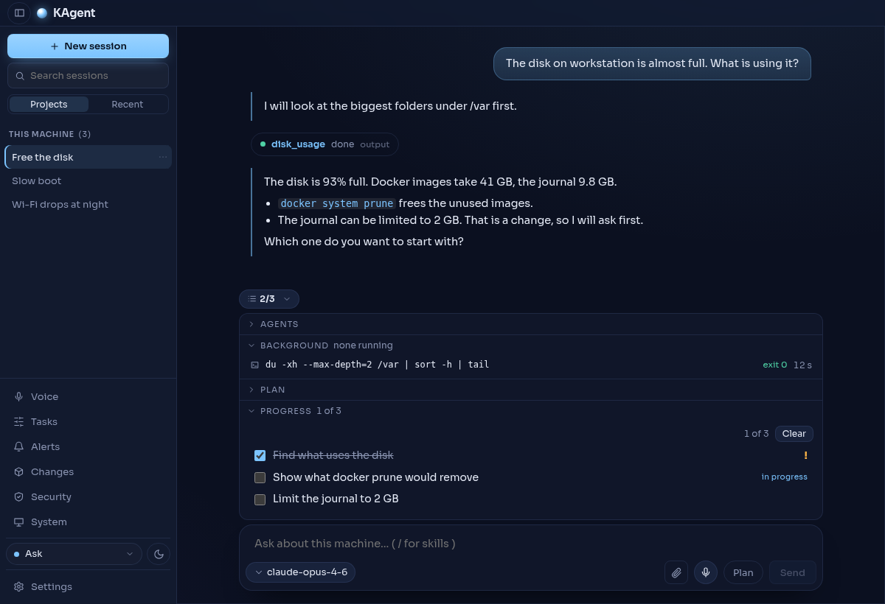
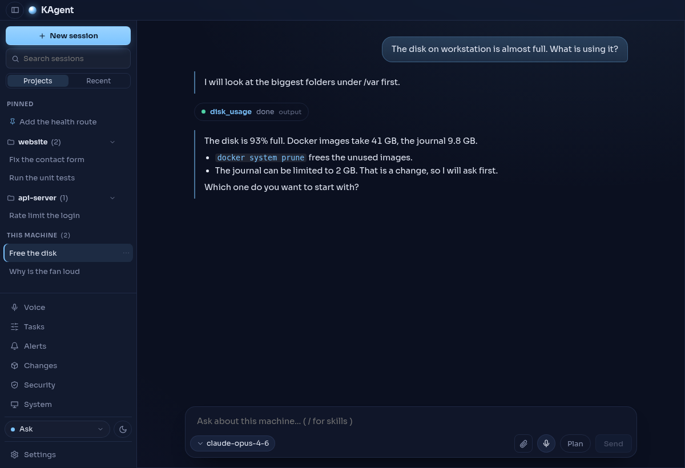
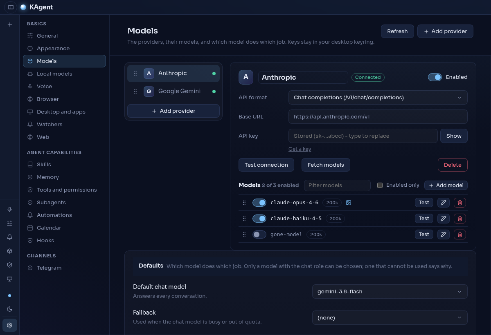
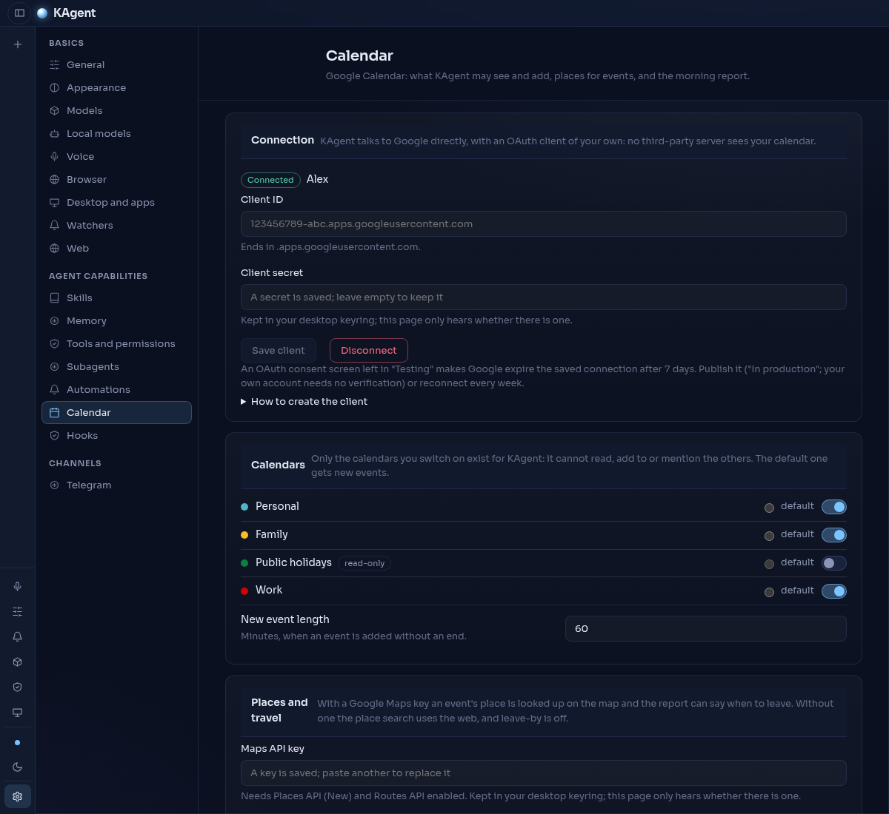
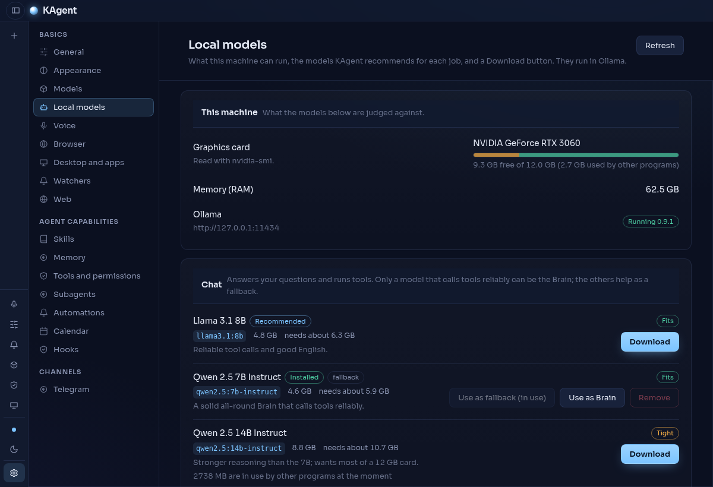
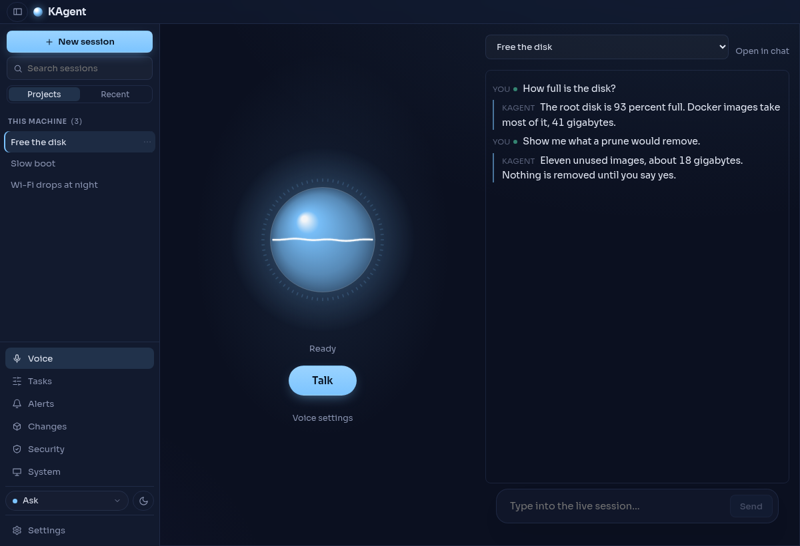
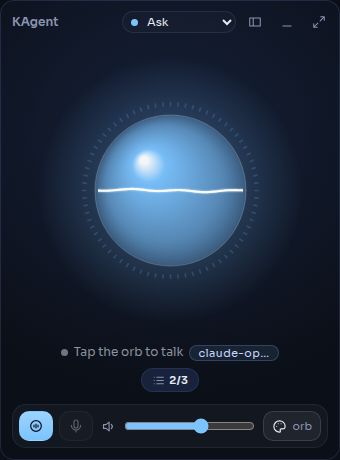
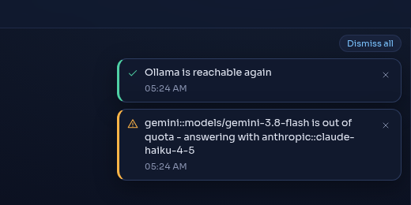

# KAgent

KAgent is an AI agent that runs on your own Linux machine. It looks at real system data (kernel, services, journal, hardware, network), makes changes only after you approve them, and can be driven by typing or by voice.

It is a Rust daemon with a small optional root helper and a React window, and it keeps your data and keys on your machine.



## What it does

- Diagnoses and changes the machine with typed, audited tools (packages, services, sysctl, kernel modules, files, power, audio, network and more).
- Every change asks first, shows a dry run where there is one, and can be undone from the change journal.
- Voice with spoken confirmation: it says what it is about to do and waits for your "yes" or "confirm".
- Watchers and intrusion alerts: kernel warnings, failed services, disk space, SSH brute force, decoy files, changes to autostart and SSH keys.
- A sidebar of projects and conversations, with a model chosen per conversation.
- Google Calendar (read, add, change, delete events) and a morning report.
- Images in chat (paste or drop one) and "look at my screen" in a voice session.
- Screen watch: "tell me when the build finishes", checked frame by frame by a local vision model.
- Local models that fit your graphics card, with a recommended list and a Download button (they run in Ollama).
- A Telegram bot, so you can talk to it from your phone.
- Skills (playbooks), memory, subagents, background commands, todo lists, plan mode and hooks.
- An MCP server, so a coding agent such as Claude Code can use KAgent's tools.

## How safety works

- **Permission modes.** `read-only` allows no changes. `ask` (the default) shows an approval card for every change. `trusted` skips the card for ordinary changes but still asks for root actions and for tools that always ask (typing into a terminal, sending messages, reboot). `full` skips every card except root actions. Per-tool rules (allow, ask, deny) apply on top.
- **Approval cards and spoken confirmation.** In the `live` and `auto` voice modes a call that would ask does not run until you confirm out loud, in every permission mode; in `routed` mode the card is answered by voice. Only your own speech counts, never the model's words.
- **The root helper.** Root actions go only through `kagent-priv`, a root-owned program started with `sudo -n`. It accepts a fixed set of typed, validated operations, computes their undo and refuses everything else. There is no root shell unless you create `/etc/kagent/allow-root-shell`. Without the helper, everything read-only still works. Spec: `docs/specs/priv-ops.md`.
- **The token guard.** The API listens on 127.0.0.1 and needs a bearer token. The agent cannot read the token file or other credential files, shell commands that name them or the API port ask in every mode, and the token is replaced in every tool output before the model sees it. Spec: `docs/specs/token-guard.md`.
- **The audit log.** Every tool call, approval and change is written to a hash-chained log. `kagentd audit verify` checks that the chain is intact.
- **Undo.** Changes go to the change journal (the Changes view); each one can be undone.

Limits, stated plainly:

- A model can be wrong, and it can misread what you asked. Read the card before you approve it.
- In `full` mode, non-root changes run in chat without asking. Use `ask` unless you want that.
- The agent runs with your user's privileges. The token guard is defence in depth, not a sandbox: code that runs as you can reach what you can reach.
- Tool output, files and web pages are treated as data, never as instructions, but a model can still be misled by them.

## Requirements

- Linux with systemd. Systems without systemd are not supported.
- A desktop: KDE Plasma (X11) is the tested one. GNOME is supported through the platform layer, with limits: on Wayland, window control needs the Window Calls extension. Other desktops get the diagnostics, changes, watchers and voice, but no dark mode switch and fewer window features. See `docs/specs/platform.md`.
- A package manager: apt (Ubuntu, Debian), dnf (Fedora, RHEL) or pacman (Arch). Arch has no security advisories, so it reports an update count instead.
- A Chromium-family browser (Chrome, Chromium, Brave, Edge) to show the window as an app, or any browser to open the page.
- Rust (stable, through rustup) and Node with pnpm, to build.
- A model provider: a cloud key (Anthropic, OpenAI, Google Gemini, OpenRouter and others) or [Ollama](https://ollama.com) for local models. Voice uses Gemini Live and needs a Gemini key.

## Build and first start

There are no packages and no release binaries yet. KAgent is built from source.

```bash
git clone https://github.com/mstumberger/KAgent.git
cd KAgent
cargo build --release -p kagentd -p kagent-priv
(cd web && pnpm install && pnpm build)
./target/release/kagentd
```

`kagentd` serves the window and the API on `http://127.0.0.1:7878`. When started from a terminal it prints a link with the token in it. The token is also in `~/.config/kagent/token`. Open the link, then add a model under Settings, Models: pick a template, paste a key (kept in the desktop keyring) and press Fetch models. For a local model, use the "Ollama (local)" template.

Optional steps, which you run yourself because KAgent never runs `sudo`:

| What | How |
|---|---|
| Root actions (packages, system services, sysctl, kernel modules) | `./target/release/kagentd sudoers` prints the lines to paste into a terminal |
| Menu entries, KRunner and a push-to-talk shortcut | `scripts/desktop-integrate.sh` |
| Start with your session | `scripts/install-service.sh` (a systemd user service) |
| KDE panel widget with a voice waveform and alert badge | `kpackagetool6 -t Plasma/Applet -i plasmoid/org.kde.kagent.voice` |
| A small always-on-top window | `scripts/kagent-overlay.sh` |
| Use KAgent from Claude Code | `claude mcp add kagent -- /path/to/kagentd mcp` |

The Tauri shell in `app/` is written but needs GTK and WebKit development packages; see `app/README.md`.

## Screenshots



The sidebar groups conversations by project, with pinned ones on top.



Providers and their models, and which model does which job.



Google Calendar connected: which calendars the agent may see, and where the morning report goes.



Local models, judged against the graphics card and its free memory.



The voice view: the orb, the transcript and the talk button.



The always-on-top widget, the same window in a compact layout.



An error stays until closed; a recovery fades after a few seconds.

The screenshots are taken from the real window against a mocked API with invented data: `scripts/take-screenshots.py`.

## Status

KAgent is an early project by one person. The version is 0.1.0 and milestone v0.0.2 is in progress. What is planned next is in `docs/TODO.md`.

What is not verified: parts of it were tested only against fakes. The Google Calendar module was tested against a fake Google, not a real account. The local-model download was tested against a fake Ollama. The Telegram bot, some voice and subagent checks with cloud models, and the Tauri shell have not been run end to end. Expect rough edges, and check the scenarios in `docs/specs/scenarios.md` for what each stage covered.

## Documentation

- `docs/IMPLEMENTATION.md`: the stages, the rules, the decisions log and the owner actions.
- `docs/specs/`: one spec per area (tools, API, config, the root helper, alerts, platform, voice, calendar, and more).
- `docs/milestones/v0.0.2.md`: the current milestone.
- `docs/TODO.md`: what is planned.
- `GLOSSARY.md`: the words the project uses.
- `AGENTS.md`: the rules for coding agents working in this repository.

## Contributing

See [CONTRIBUTING.md](CONTRIBUTING.md). To report a vulnerability, see [SECURITY.md](SECURITY.md).

## Licence

GPL-3.0-or-later. The full text is in [LICENSE](LICENSE).
